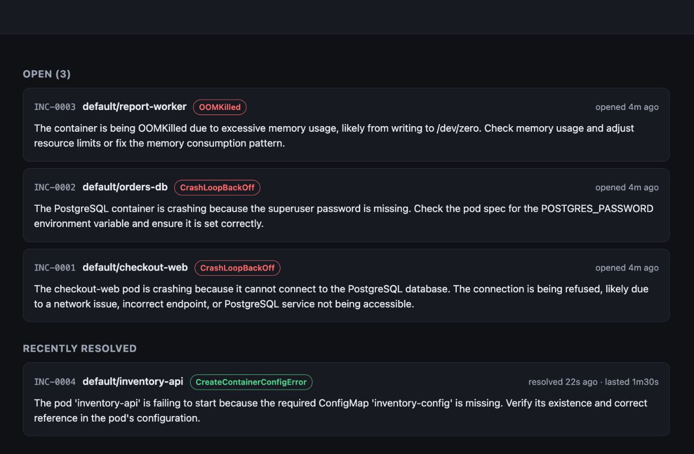
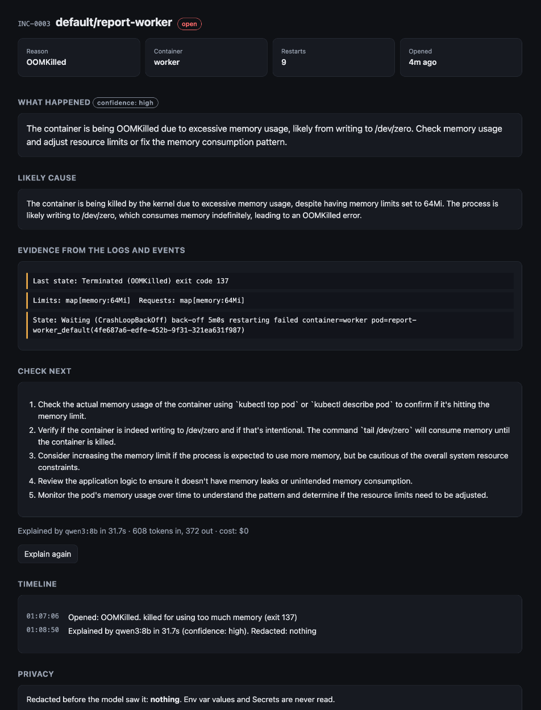

# 🧯 Incident Explainer

A small incident manager for Kubernetes that explains broken pods in plain English, using an **open-weight model running on your own hardware**.

It watches your cluster, opens an incident when a pod breaks (CrashLoopBackOff, OOMKilled, ImagePullBackOff, a missing Secret, a failing probe), collects the evidence, **redacts secrets**, and asks a local model in [Ollama](https://ollama.com) what went wrong and what to check next. When the pod is healthy again, the incident resolves itself.

Your logs never leave your infrastructure. There is no API key and no per-token bill.



## Why a local, open model

Pod logs are some of the most sensitive data a company has: connection strings, tokens, customer emails, internal IPs. Most teams are not allowed to paste them into a hosted AI chat, so on-call engineers read them by hand at 3 AM.

With an open-weight model (Qwen 3 8B by default, any Ollama model works):

- **Data stays inside.** The model runs next to the cluster. Nothing is sent to a third party.
- **It costs nothing per incident.** A crash loop that fires 200 times a night does not turn into a bill.
- **You can swap the model** for a bigger one, a smaller one, or one fine-tuned on your own runbooks.

Redaction still happens first, because "local" should not mean "careless".

## What it looks like



Each incident shows:

- **What happened**: one or two sentences a manager can read
- **Likely cause**, with **evidence**: the exact log and event lines it is based on
- **Check next**: concrete commands, most useful first
- **Timeline**: opened, explained, resolved
- **Privacy**: what was redacted, and exactly what the model saw

New incidents can also be posted to Slack, Teams or Mattermost through an incoming webhook.

## Quick start (kind, about 5 minutes)

You need Docker, [kind](https://kind.sigs.k8s.io), kubectl, Go 1.27+ and Ollama.

```bash
ollama pull qwen3:8b          # once

make kind-up                  # local cluster called incident-demo
make deploy                   # build the image, load it into kind, apply deploy/
make demo                     # four pods that break in four different ways
make ui                       # http://localhost:8080
```

Within a minute you should see four open incidents. To watch one resolve, fix it:

```bash
kubectl create secret generic payments-secrets --from-literal=stripe-api-key=sk_test_dummy
```

Explain a single log file or an infrastructure plan without a cluster:

```bash
make build
./bin/incident-explainer explain demo/rds-change-sample.txt
kubectl logs my-pod --previous | ./bin/incident-explainer explain -
./bin/incident-explainer explain -dry-run app.log    # show what would be sent, send nothing
```

## How it works

```
 every 15s                           one at a time
┌──────────┐  broken?  ┌──────────┐  ┌───────────────────────────┐   ┌──────────────┐
│ list pods│──────────▶│ incident │─▶│ describe + events + logs  │──▶│ Ollama        │
└──────────┘           │  opened  │  │ (previous run if crashed) │   │ qwen3:8b      │
      ▲                └──────────┘  │ → redact → trim to budget │   │ JSON schema   │
      │ healthy 4 checks in a row    └───────────────────────────┘   └──────┬───────┘
      └──────────── incident resolved ◀──── web UI / webhook ◀──────────────┘
```

- **Detection** reads only pod status. An OOMKilled container is reported as OOMKilled, not as the generic CrashLoopBackOff it also shows. A container that crashed in the last 10 minutes still counts as broken, so crash loops do not flap between open and resolved.
- **Evidence** is built like `kubectl describe`, but env vars show only their names and where they come from. Values are never collected.
- **Redaction** masks private keys, AWS keys, JWTs, bearer tokens, passwords in URLs, `password=` / `token=` / `api_key=` values, emails and single IP addresses. CIDR ranges like `0.0.0.0/0` are kept on purpose, because they are often the actual problem.
- **The model** must answer with a fixed JSON schema (summary, likely cause, evidence, next steps, confidence), and is told to say so when the input is not enough.

## Security

- **Read-only RBAC**: `get/list/watch` on pods, pods/log and events. It cannot read Secrets or change anything (`kubectl auth can-i get secrets` → `no`).
- **13 MB `FROM scratch` image**: no shell, no package manager, runs as non-root with a read-only root filesystem and all capabilities dropped.
- **Logs are redacted before** they reach the model, even though the model is local.

## Configuration

| Variable | Default | Meaning |
|---|---|---|
| `OLLAMA_HOST` | `http://localhost:11434` | Ollama URL (`http://host.docker.internal:11434` from kind) |
| `MODEL` | `qwen3:8b` | Any model pulled into Ollama |
| `POLL_INTERVAL` | `15s` | How often to check pods |
| `RESOLVE_AFTER` | `4` | Healthy checks in a row before an incident resolves |
| `IGNORE_NAMESPACES` | `kube-system,…` | Namespaces to skip |
| `WEBHOOK_URL` | | Slack / Teams / Mattermost incoming webhook |
| `UI_URL` | | Link used in webhook messages |
| `DATA_FILE` | `incidents.json` | Where incidents are stored |
| `KEEP_IPS` | `false` | Do not mask IP addresses |
| `KUBE_API` | | Run outside the cluster, e.g. `http://127.0.0.1:8001` from `kubectl proxy` |

## Limits (honest list)

- One replica, incidents stored in a JSON file. Fine for a team cluster, not for 5,000 nodes.
- It explains, it does not fix. Any action is still a human decision.
- An 8B model is good at the common failures above. For rarer ones, use a larger model or check the evidence it quotes.
- Redaction is pattern based. It catches the common shapes of secrets, not every possible one. Use `-dry-run` to see exactly what would be sent.

## Tests

```bash
make test
```

Covers redaction (secrets out, CIDR ranges and kubectl placeholders kept), trimming, and detection of each failure type.

## License

MIT
